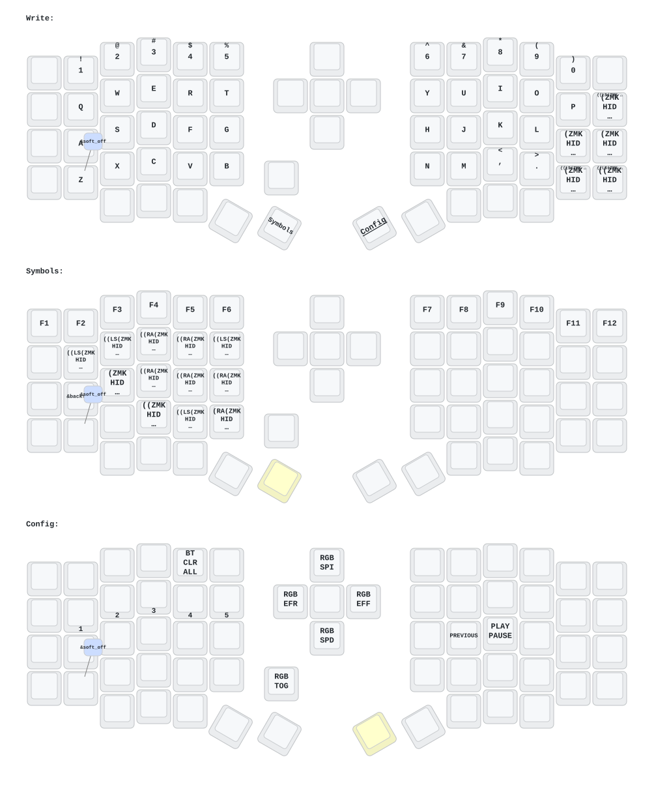

# Sofle

Eyelash Sofle Keyboard ZMK Wireless

## Hardware

- Placa base **nice!nano** nRF52840
- Pantallas **nice!view** en ambas mitades.
- Lado izquierdo: perilla con **encoder giratorio y pulsación**.
- Lado derecho: **cruceta direccional con pulsación**.

## Mapa de teclas

En las teclas de escritura, el carácter central corresponde a una pulsación normal. Los símbolos adicionales indican qué se escribe con **Shift** (arriba) o con **Opción / Alt** (abajo).



En la capa **Config**, pulsa la tecla de la bombilla con una A si la iluminación se ve blanca. Restaura la saturación al 90 % y fija el tono en 90° y el brillo en el 40 %. Después puedes recorrer los colores con ↑ y ↓.

### Atajos de reinicio y flasheo

Mantén pulsada **CAPA** (`BT | RGB | Sound`), la tecla del pulgar derecho junto a Espacio. Sin soltarla, pulsa **RESET** o **BOOT** en el borde exterior de la mitad que quieras reiniciar.

```text
       Mitad izquierda                Mitad derecha
   [  ][  ][  ][  ][  ][  ]    [  ][  ][  ][  ][  ][  ]
   [  ][  ][  ][  ][  ][  ]    [  ][  ][  ][  ][  ][  ]
[RESET][  ][  ][  ][  ][  ]    [  ][  ][  ][  ][  ][RESET]
[BOOT ][  ][  ][  ][  ][  ]    [  ][  ][  ][  ][  ][BOOT ]
           [  ][  ][  ][  ][  ]    [CAPA][  ][  ][  ][  ]
```

- **RESET** (`&sys_reset`) reinicia la mitad con el firmware instalado. Ocupa la posición de **Caps Lock** a la izquierda y del **acento** (`´`) a la derecha.
- **BOOT** (`&bootloader`) abre el gestor de arranque para cargar un nuevo `.uf2`. Está justo debajo de RESET, en **Shift izquierdo** o **¡/¿**.

Cada atajo actúa solo sobre la mitad donde lo pulsas. El reinicio normal conserva los emparejamientos Bluetooth y la configuración guardada.

## Compilación
El firmware se compila automáticamente a través de GitHub Actions al realizar un «push». Descarga los archivos .uf2 desde la pestaña «Actions».


## Flasheo
Conecta una mitad mediante USB.
Usa el atajo `&bootloader` de esa mitad o pulsa dos veces el botón físico de reinicio del nice!nano. La mitad conectada aparecerá como una unidad USB.
Arrastra el archivo .uf2 correspondiente a la unidad.
Orden de programación para el emparejamiento: primero la mitad derecha y, a continuación, la mitad izquierda.

## Reestablecer la configuración
Carga el archivo settings_reset.uf2 para borrar los emparejamientos de Bluetooth y la configuración almacenada en ambas mitades. A continuación, vuelve a flashear el firmware normalmente.
