# Sofle

Eyelash Sofle Keyboard ZMK Wireless

## Hardware

- Placa base **nice!nano** nRF52840
- Pantallas **nice!view** en ambas mitades.
- Lado izquierdo: perilla con **encoder giratorio y pulsación**.
- Lado derecho: **cruceta direccional con pulsación**.

## Mapa de teclas

## Compilación
El firmware se compila automáticamente a través de GitHub Actions al realizar un «push». Descarga los archivos .uf2 desde la pestaña «Actions».

## Flasheo
Conecta una mitad mediante USB.
Haz doble clic en el botón de reinicio del nice!nano para acceder al gestor de arranque (aparece como una unidad USB).
Arrastra el archivo .uf2 correspondiente a la unidad.
Orden de programación para el emparejamiento: primero la mitad derecha y, a continuación, la mitad izquierda.

## Reestablecer la configuración
Carga el archivo settings_reset.uf2 para borrar los emparejamientos de Bluetooth y la configuración almacenada en ambas mitades. A continuación, vuelve a flashear el firmware normalmente.

## Archivos originales para restaurar firmware

En [bkp/](bkp/) se conservan los archivos copiados de las unidades USB del
bootloader del teclado.